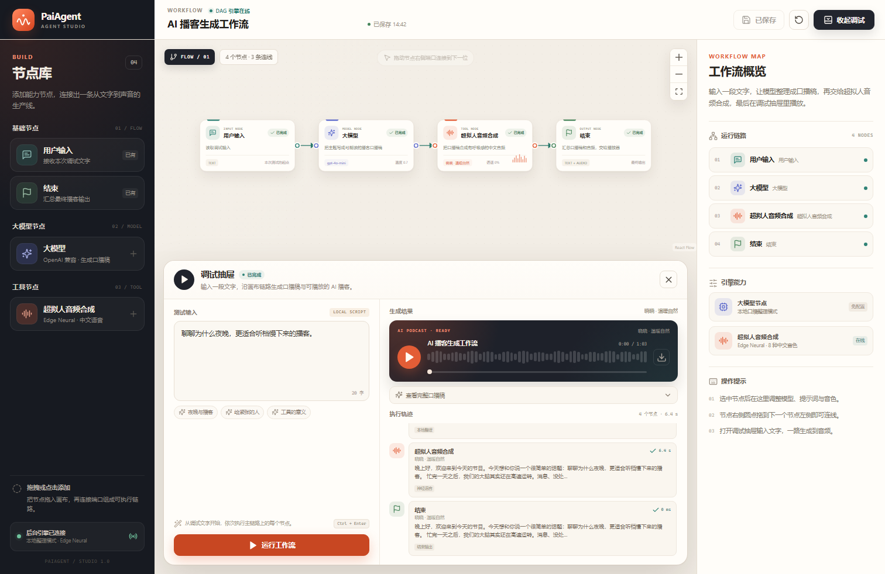

# PaiAgent Studio

一个可以本地跑通的 AI 播客 Agent：在画布上编排「用户输入 → 大模型 → 超拟人音频合成 → 结束」，在调试抽屉里输入一段文字，实时查看 DAG 执行轨迹，并直接播放或下载生成的播客 MP3。

完整文档：[用户说明手册](docs/user-manual.md)（安装、画布操作、调试与常见问题）、[设计文档](docs/design.md)（架构、引擎、API）、[项目总结](docs/project-summary.md)（交付与验收）、[阶段总结](docs/phase-summary.md)（五阶段过程）。



## 功能

- **可视化工作流画布**：基于 React Flow，支持拖拽节点、点击添加、连接端口、缩放与平移。
- **可配置节点**：大模型节点可改模型、温度、系统提示词；语音节点可选择 8 种中文神经音色并调整语速、音调。
- **流式执行反馈**：后端以 NDJSON 推送开始/完成/失败事件，画布节点和调试轨迹实时更新。
- **真实音频生成**：使用 Edge Neural TTS 输出 MP3，内置播放器支持播放、进度拖动、下载。
- **零配置可体验**：没有配置大模型密钥时，LLM 节点自动使用本地口播整理器，整条链路仍然可用。
- **工作流持久化**：保存到后端 SQLite，刷新页面后自动恢复；测试文字保存在浏览器本地。
- **DAG 校验**：拒绝缺失入口/出口、孤立节点、环路、重复连线等非法图结构，并给出中文错误提示。
- **安全边界**：模型地址和密钥只从后端 `.env` 读取，不接受前端传入的任意服务地址。

## 技术栈

| 层 | 技术 |
| --- | --- |
| 前端 | React 19、TypeScript、Vite 6、@xyflow/react 12、lucide-react |
| 后端 | FastAPI、Pydantic、httpx、Uvicorn |
| 工作流 | 自研 DAG 引擎：校验、拓扑排序、节点执行、流式事件 |
| LLM | OpenAI 兼容的 Chat Completions 接口，可接 DeepSeek / 通义千问 / GLM / OpenAI |
| TTS | `edge-tts` 中文神经语音 |
| 存储 | SQLite（工作流文档）+ 本地文件（音频，24 小时清理） |

## 快速开始（Windows）

环境要求：Python 3.12+、Node.js 20+。

```bat
setup.bat
start.bat
```

`setup.bat` 会创建 Python 虚拟环境、安装前后端依赖、生成 `backend\.env` 并运行后端单元测试。`start.bat` 会在两个窗口分别启动服务并打开浏览器。

- 前端：<http://127.0.0.1:5180>
- 后端：<http://127.0.0.1:8010>
- API 文档：<http://127.0.0.1:8010/docs>

启动脚本会自动寻找 Node 20+：优先项目内 `.tools\node`，其次本机已安装的现代 Node。Python 优先使用 `py -3.12`。若提示缺失，请先安装对应运行时。

## 手动启动

后端：

```bat
cd backend
py -3.12 -m venv .venv
.venv\Scripts\python.exe -m pip install -r requirements.txt
copy .env.example .env
.venv\Scripts\python.exe -m uvicorn app.main:app --host 127.0.0.1 --port 8010
```

前端：

```bat
cd frontend
npm install
npm run dev
```

## 配置大模型

编辑 `backend\.env`（保存后下一次运行自动生效，无需重启）：

```ini
LLM_BASE_URL=https://api.deepseek.com/v1
LLM_API_KEY=你的密钥
LLM_MODEL=deepseek-chat
```

常用 OpenAI 兼容服务：

| 服务 | Base URL | 模型示例 |
| --- | --- | --- |
| DeepSeek | `https://api.deepseek.com/v1` | `deepseek-chat` |
| 通义千问 | `https://dashscope.aliyuncs.com/compatible-mode/v1` | `qwen-plus` |
| 智谱 GLM | `https://open.bigmodel.cn/api/paas/v4` | `glm-4-flash` |
| OpenAI | `https://api.openai.com/v1` | `gpt-4o-mini` |

不填 `LLM_API_KEY` 时使用本地口播整理器。语音合成需要联网访问 Edge TTS 服务，不需要密钥。

## 使用方式

1. 从左侧节点库拖拽或点击「大模型」「超拟人音频合成」等节点。
2. 拖动节点右侧端口到下一个节点左侧端口完成连线。
3. 选中节点，在右侧修改模型、提示词、音色、语速和音调。
4. 在底部调试抽屉输入文字，点击「运行工作流」（或 `Ctrl/Cmd + Enter`）。
5. 执行完成后，在「生成结果」中播放或下载 MP3。
6. 点击「保存」将工作流写入后端；刷新页面会自动恢复。

工作流必须满足：有且仅有一个用户输入节点和一个结束节点；所有节点都在「用户输入 → 结束」主链路上；不允许环路、重复连线或不支持的节点类型。口播稿超过 3000 字会在语音节点被拒绝。

## 项目结构

```text
myPaiAgent2/
├─ backend/
│  ├─ app/
│  │  ├─ engine/          # DAG 校验、拓扑排序、执行器
│  │  ├─ nodes/           # 用户输入 / LLM / TTS / 结束节点
│  │  ├─ config.py        # 环境变量与数据目录
│  │  ├─ main.py          # FastAPI 接口与音频静态服务
│  │  ├─ schemas.py       # 请求/图结构模型
│  │  ├─ store.py         # SQLite 工作流持久化
│  │  └─ voices.py        # 中文音色清单
│  ├─ tests/              # 引擎与文本工具单元测试
│  ├─ .env.example
│  └─ requirements.txt
├─ frontend/
│  ├─ src/
│  │  ├─ components/      # 画布、节点、调试抽屉、播放器、检查器
│  │  ├─ api.ts           # 后端请求与 NDJSON 解析
│  │  ├─ Studio.tsx       # 工作室状态与交互
│  │  ├─ workflow.ts      # 默认图、序列化、校验辅助
│  │  └─ styles.css       # 设计系统与完整界面样式
│  └─ vite.config.ts      # 5180 端口与 /api 代理
├─ scripts/               # Windows 环境检测与启动脚本
├─ docs/                  # 用户手册、设计文档、项目总结、阶段总结
├─ setup.bat
└─ start.bat
```

## API

| 方法 | 路径 | 说明 |
| --- | --- | --- |
| `GET` | `/api/health` | 服务健康状态 |
| `GET` | `/api/studio` | 音色、模型配置状态、已保存工作流 |
| `GET` | `/api/voices` | 中文音色列表 |
| `GET` | `/api/workflows/current` | 读取当前工作流 |
| `PUT` | `/api/workflows/current` | 保存当前工作流 |
| `POST` | `/api/workflows/run` | 运行工作流，返回 NDJSON 事件流 |
| `GET` | `/api/audio/{file}.mp3` | 获取生成的音频 |

## 测试与构建

```bat
cd backend
.venv\Scripts\python.exe -m unittest discover -s tests

cd ..\frontend
npm run typecheck
npm run build
```

生产模式下可先执行 `npm run build`，随后只启动后端：FastAPI 会自动托管 `frontend\dist`，访问 <http://127.0.0.1:8010> 即可。

## 数据说明

- 工作流文档：`backend/data/studio.db`
- 生成的音频：`backend/data/audio/*.mp3`，服务启动时清理超过 24 小时的文件
- 测试输入草稿：浏览器 `localStorage`
- 密钥：仅保存在 `backend/.env`，该文件与运行数据均已加入 `.gitignore`

## 常见问题

- **语音合成失败**：Edge TTS 需要外网连接，请检查网络后重试；生成 64 秒音频通常需要十余秒。
- **没有生成真实大模型文案**：检查 `backend/.env` 中 `LLM_API_KEY` 是否填写，调试抽屉里的模式标签会显示 `LOCAL SCRIPT` 或已接入大模型。
- **端口被占用**：默认使用 5180 / 8010；修改时需同步调整 `frontend/vite.config.ts` 代理、`scripts/start-backend.bat` 以及 `backend/app/config.py` 的 CORS 来源。
- **浏览器拦截播放**：再点一次播放按钮即可，这是浏览器的自动播放策略。
